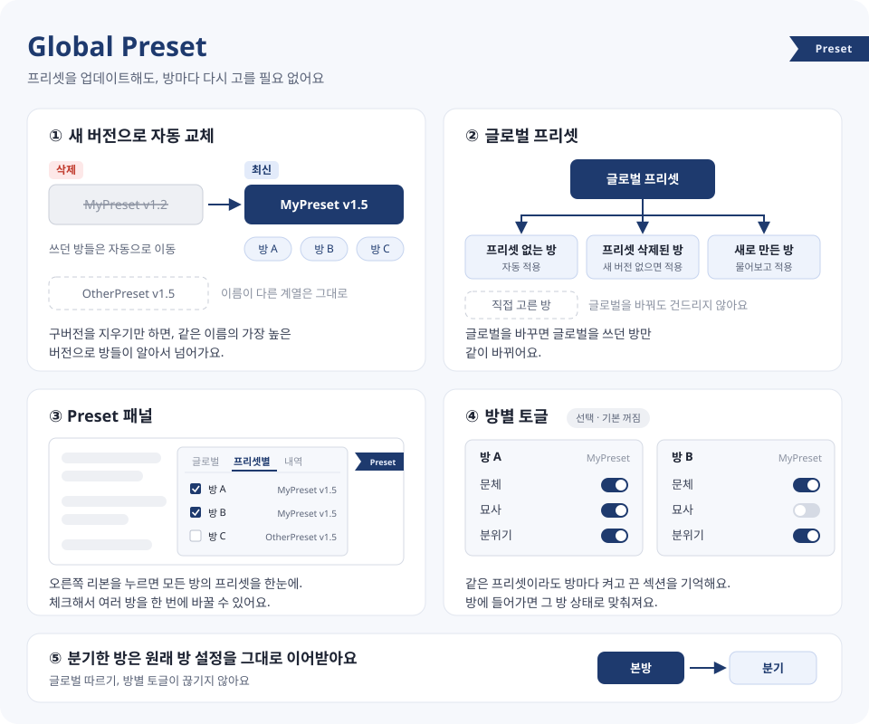

# Global Preset

[마리나라 엔진](https://github.com/Pasta-Devs/Marinara-Engine)에서 프리셋을 업데이트할 때마다 방마다 다시 지정하던 귀찮음을 없애주는 확장입니다.

## 뭘 해주나요

- **새 버전으로 자동 교체** — 구버전 프리셋을 지우면, 그걸 쓰던 방들이 같은 계열의 최신 버전으로 알아서 넘어갑니다.
  예) `MyPreset v1.2` 삭제 → `MyPreset v1.5` (`OtherPreset v1.5`는 다른 계열이라 그대로)
- **글로벌 프리셋** — 프리셋이 없는 방엔 글로벌 프리셋이 들어갑니다. 글로벌을 바꾸면 글로벌을 쓰던 방만 같이 바뀌어요.
- **Preset 패널** — 화면 오른쪽 끝의 파란 `Preset` 리본을 누르면 열려요. 모든 방의 프리셋을 한눈에 보고, 체크해서 여러 방을 한 번에 바꿀 수 있습니다. 확장이 바꾼 기록도 여기서 확인.
- **방별 토글 기억** (선택, 기본 꺼짐) — 같은 프리셋이라도 방마다 섹션 켜기/끄기를 따로 기억합니다.
- **분기한 방** — 원래 방 설정(글로벌 따르기, 방별 토글)을 그대로 이어받습니다.

## 프리셋 업데이트하는 법

1. 구버전 프리셋 삭제
2. 새 버전 가져오기
3. 끝. 방에 들어가거나 Preset 패널을 열면 자동으로 바뀝니다.

## 주의사항

- **Full page access 권한이 필요합니다.** 마리나라 자체 API만 쓰고 외부로 나가는 요청은 없습니다.
- **처음 쓰기 전에 data 폴더 백업 권장.** 여러 방을 한꺼번에 바꾸는 기능이 있어서요.
- **자동 교체는 확장을 설치한 뒤에 지운 프리셋부터 됩니다.** 이미 지운 건 되돌릴 수 없어요.
- `X` ↔ `X Lite`처럼 이름이 살짝 다른 것도 같은 계열로 봅니다. 엉뚱하게 바뀌면 Preset 패널에서 고쳐주세요.
- 기본은 **롤플레이 모드만** 관리합니다. 게임/대화 모드는 Preset 패널에서 켤 수 있어요.
- 연결(Connection)에 프리셋이 지정된 방은 그쪽이 우선이라 건드리지 않습니다.
- 방을 계속 프리셋 없이 두고 싶으면 마리나라 설정창 말고 Preset 패널에서 `(없음)`을 고르세요. 설정창에서 비우면 글로벌이 다시 들어갑니다.
- 방별 토글을 켠 상태로 **두 방에서 동시에 생성**하면 토글이 섞일 수 있어요. 기본 내장 프리셋에는 적용되지 않습니다.
- 화면이 바로 안 바뀌면 새로고침하세요. 저장은 정상적으로 됩니다.
